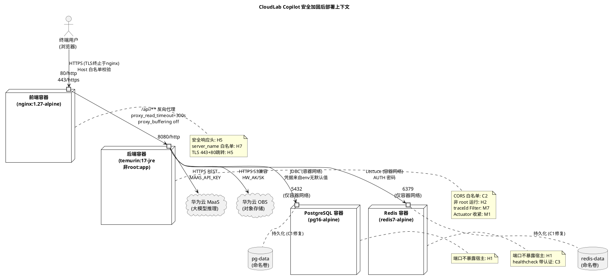
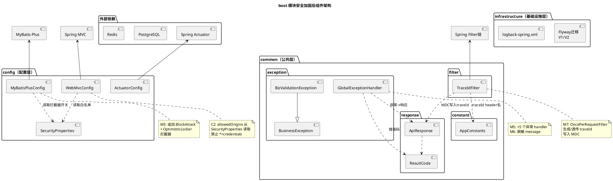
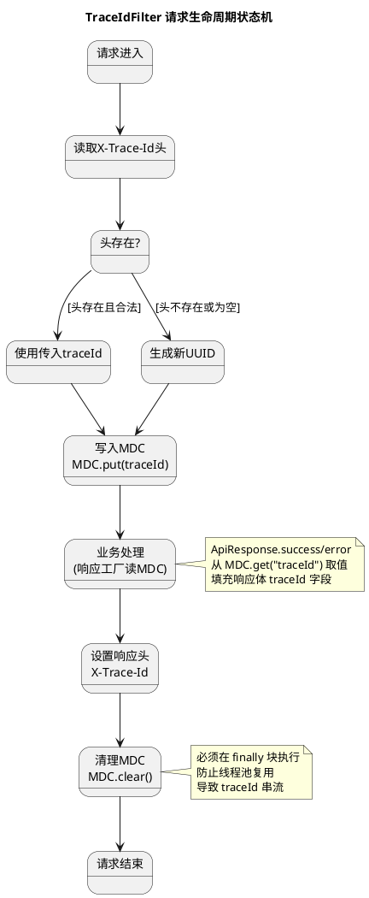
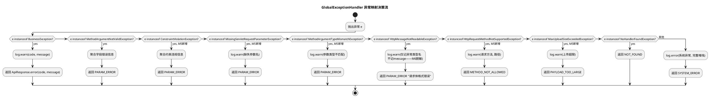
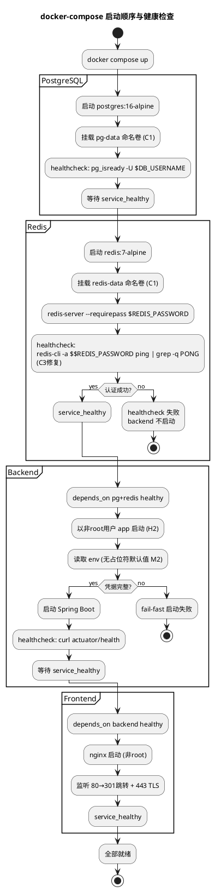
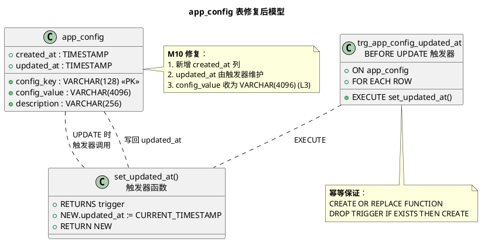
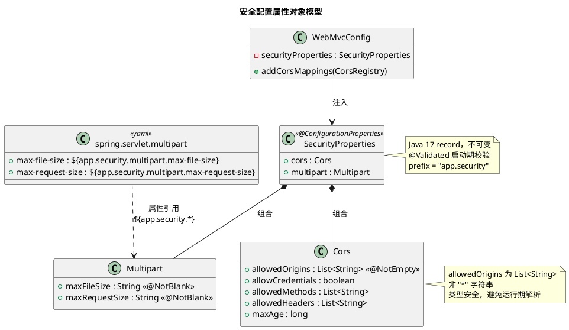
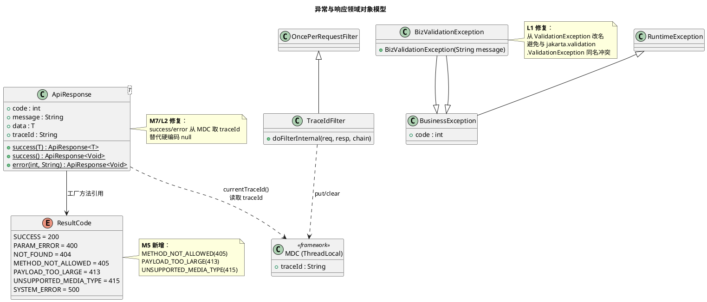

# CloudLab Copilot 安全审查修复 — 技术设计文档

> 本文档由 spec-design-agent 生成，对应需求规格：`docs/spec/requirements.md`
> 范围：3 个严重（C1–C3）、7 个高危（H1–H7）、20 个中危（M1–M20）、12 个低危（L1–L12），共 42 项。
> 项目当前处于骨架阶段（业务模块均为 `Placeholder`），本次设计聚焦**基础设施配置、安全基线、骨架代码缺陷**三层的增量修复，不涉及业务逻辑实现。

---

# 一、需求与存量功能关系分析

## 1.1 需求功能与存量功能对比

本次安全审查的 42 项问题可按**修复落点**归并为 8 个技术分组。下表先给出分组总览，再逐组展开"已实现 / 需扩展 / 需新增"三态分析。

| 分组 | 覆盖问题 | 主要落点文件 | 修复性质 |
|------|---------|------------|---------|
| G1 容器编排与镜像加固 | C1, C3, H1, H2, H3, M16, M17, L6, L10, L11 | `docker-compose.yml`、`backend/Dockerfile`、`frontend/Dockerfile`、新增 `.dockerignore` | 配置改造 + 新增文件 |
| G2 后端安全配置 | C2, H6, M1, M2, M4, M9, L9 | `WebMvcConfig.java`、`application*.yml`、`.env.example` | 配置改造 |
| G3 后端骨架代码增强 | M3, M5, M6, M7, M10, L1, L2, L3 | `MyBatisPlusConfig.java`、`GlobalExceptionHandler.java`、`ApiResponse.java`、`V1__init.sql`、新增 `TraceIdFilter` | 代码扩展 + 新增类 |
| G4 日志与可观测性 | M8, L8 | `logback-spring.xml` | 配置改造 |
| G5 Nginx 与前端构建 | H5, H7, M11, M12, M13, M14, M15, M19, L7, L12 | `frontend/nginx.conf`、`vite.config.ts`、`request.ts`、`router/index.tsx`、新增 `ErrorBoundary` | 配置改造 + 新增组件 |
| G6 依赖 CVE 升级 | H4 | `backend/pom.xml`、`frontend/package.json` | 版本升级 |
| G7 测试与工程规范 | L4, L5 | `backend/boot/pom.xml`、`frontend/package.json`、新增测试目录 | 新增依赖 + 目录 |
| G8 脚本与敏感信息 | M18, M20 | `scripts/verify-startup.sh`、`resources/` | 脚本改造 + 历史清理 |

### 1.1.1 已实现功能

下表列出需求中与存量代码**完全匹配或高度相似**、可直接复用其结构仅需调整参数的部分。

| 需求功能 | 存量功能 | 代码位置 | 匹配度 |
|---------|---------|---------|--------|
| C2 CORS 白名单收紧 | 已有 `WebMvcConfigurer.addCorsMappings` 实现 | `backend/boot/.../config/WebMvcConfig.java:10-18` | 75% |
| C3 Redis healthcheck 带认证 | 已有 `healthcheck` 块（仅缺 `-a` 认证参数） | `docker-compose.yml:21-25` | 75% |
| H1 端口暴露收敛 | 已有 `ports` 映射声明 | `docker-compose.yml:4-5,18-19` | 75% |
| M1 Actuator show-details 收紧 | 已有 `management.endpoint.health.show-details` 配置项 | `application-dev.yml:14` | 75% |
| M3 MyBatis-Plus 拦截器增强 | 已有 `MybatisPlusInterceptor` Bean 与 `PaginationInnerInterceptor` | `backend/boot/.../config/MyBatisPlusConfig.java:12-17` | 75% |
| M5 异常处理扩展 | 已有 `GlobalExceptionHandler` + 5 个 `@ExceptionHandler` | `backend/boot/.../exception/GlobalExceptionHandler.java:20-51` | 50% |
| M7 traceId 注入 | 已有 `ApiResponse.traceId` 字段与 `AppConstants.DEFAULT_TRACE_ID_HEADER`、logback `%X{traceId}` 占位 | `ApiResponse.java:15`、`AppConstants.java:9`、`logback-spring.xml:8` | 50% |
| M9 Jackson 日期格式 | 已有 `spring.jackson.date-format` 配置项 | `application.yml:24-26` | 75% |
| M13 前端响应拦截器 | 已有 axios `interceptors.response.use` 骨架 | `frontend/src/api/request.ts:18-25` | 50% |
| M14 前端路由 | 已有 `createBrowserRouter` 骨架 | `frontend/src/router/index.tsx:4-9` | 50% |
| M19 Nginx 代理超时 | 已有 `location /api/` 代理块 | `frontend/nginx.conf:11-17` | 75% |
| H4 依赖版本升级 | 已有 `spring-boot.version` 等属性占位 | `backend/pom.xml:34-38`、`frontend/package.json:13-33` | 75% |

> **判定依据**：匹配度 75% 表示"已有同名配置/Bean/结构，仅需改参数或加少量条目"；50% 表示"已有骨架但缺关键分支/字段填充"。

### 1.1.2 需要扩展的功能

下表列出需求与存量代码**部分匹配**、需在现有基础上改造的部分。

| 需求功能 | 存量功能 | 差异说明 | 扩展方向 |
|---------|---------|---------|---------|
| C2 CORS 白名单 | `allowedOriginPatterns("*")` | 输入差异：需从环境变量读取白名单而非硬编码 `*`；业务差异：dev 允许 localhost、prod 仅允许显式域名 | 改 `WebMvcConfig` 读 `app.cors.allowed-origins` 配置，按 profile 注入；新增 `application-prod.yml` 白名单 |
| C3 Redis healthcheck | `redis-cli ping` | 缺 `-a $$REDIS_PASSWORD` 认证；shell 变量需用 `$$` 转义 | 改 `docker-compose.yml` healthcheck `test` 为 `CMD-SHELL` 并带认证 |
| M1 Actuator | `show-details: always` | dev 暴露 DB/Redis 连接信息 | 改为 `when_authorized` |
| M3 MyBatis-Plus | 仅 `PaginationInnerInterceptor` | 缺 `BlockAttackInnerInterceptor`（防全表 update/delete）、`OptimisticLockerInnerInterceptor` | 在 `mybatisPlusInterceptor()` 中按顺序追加两个内拦截器 |
| M5 异常处理 | 5 个 handler | 缺 `ConstraintViolationException`、`MissingServletRequestParameterException`、`MethodArgumentTypeMismatchException`、`HttpRequestMethodNotSupportedException`、`MaxUploadSizeExceededException` 共 5 个 | 在 `GlobalExceptionHandler` 追加 5 个 `@ExceptionHandler` 方法 |
| M6 日志脱敏 | `log.warn("请求体不可读: {}", e.getMessage())` | `e.getMessage()` 可能含请求体片段 | 改为仅记录异常类型名，不记录 message |
| M7 traceId | 字段与占位存在但无 Filter 写入 MDC | 缺 `OncePerRequestFilter` 生成/透传 traceId 并写入 MDC | 新增 `TraceIdFilter`，注册为最早执行的 Filter；`ApiResponse` 工厂方法从 MDC 取 traceId |
| M9 Jackson | `yyyy-MM-dd HH:mm:ss` | 丢失时区与毫秒精度 | 改为 ISO-8601 `yyyy-MM-dd'T'HH:mm:ss.SSSXXX` |
| M13 前端拦截器 | 空实现 | 未读取 `response.data.code`、未 toast 业务错误、未处理 401/403 | 扩展 response interceptor：业务码非 200 时 reject 并 toast；新增 error interceptor 统一提示 |
| M14 前端路由 | 单条 `/` 路由 | 缺 `path: '*'` 兜底、缺 `lazy()` 懒加载 | 改 `router/index.tsx`：用 `lazy()` 动态导入页面，追加 404 路由 |
| M19 Nginx 代理 | 基础代理头 | 缺 `proxy_read_timeout`、`proxy_buffering off`（SSE）、`client_max_body_size` | 在 `location /api/` 追加超时与缓冲配置 |
| H4 依赖升级 | 版本属性 | Spring Boot 3.2.5→3.2.12、axios 1.7.7→1.7.8、Vite 5.4.3→5.4.10、PG JDBC 42.7.3→42.7.4、MyBatis-Plus 3.5.5→3.5.9、ESLint 8→9 | 改 `pom.xml` 属性与 `package.json` 版本号；ESLint 9 需同步迁移 flat config |

### 1.1.3 需要新增的功能或接口

下表列出需求在存量代码中**完全没有对应实现**、需新增文件或组件的部分。

| 所属分组 | 新增项 | 输入 | 输出 / 效果 | 核心逻辑 | 依赖关系 |
|---------|--------|------|-----------|---------|---------|
| G1 | `backend/.dockerignore`、`frontend/.dockerignore` | — | 构建上下文排除 `target/`、`node_modules/`、`.env`、`*.iml` 等 | 静态忽略规则文件 | 被 Dockerfile `COPY . .` 隐式消费 |
| G1 | `docker-compose.yml` 顶层 `volumes` 声明 + 服务 `volumes` 挂载 | — | pg/redis 数据持久化到命名卷 | compose volumes 语法 | 依赖 C1 |
| G1 | `docker-compose.yml` 自定义 `networks` + `restart` + `mem_limit`/`cpus` + `logging` | — | 网络隔离、自动重启、资源限制、日志轮转 | compose 网络/部署配置 | 依赖 M16 |
| G1 | `backend/Dockerfile` 非 root `USER app` | — | 容器以 uid 1000 运行 | `RUN addgroup/adduser` + `USER app` + `chown /app` | 依赖 H2 |
| G1 | `backend/Dockerfile` OCI `LABEL` | — | 镜像元数据符合 OCI 规范 | `LABEL org.opencontainers.image.*` | 依赖 L6 |
| G1 | `backend/.env`、`frontend/.env` 拆分 | — | 前后端环境变量分离 | compose `env_file` 分别指向 | 依赖 L10 |
| G3 | `TraceIdFilter.java` | HTTP 请求 | MDC 写入 `traceId`；响应头 `X-Trace-Id` | `OncePerRequestFilter`：优先读请求头，无则生成 UUID；`finally` 清理 MDC | 被 `ApiResponse` 工厂方法读取 MDC |
| G3 | `V2__audit_columns.sql`（Flyway 迁移） | — | `app_config` 增加 `created_at` 列；`updated_at` 触发器 | `ALTER TABLE` + `CREATE OR REPLACE FUNCTION/TRIGGER` | 依赖 Flyway、M10 |
| G3 | `BizValidationException.java`（L1 改名） | — | 替换 `ValidationException` 同名冲突 | 重命名 + 全局替换引用 | 依赖 L1 |
| G5 | `frontend/src/components/ErrorBoundary.tsx` | React 子树 | 捕获渲染异常显示降级 UI | 类组件 `getDerivedStateFromError` + `componentDidCatch` 上报 | 被 `App.tsx` 包裹路由 |
| G5 | `frontend/src/pages/NotFound.tsx` | — | 404 兜底页 | 静态组件 | 被 `router/index.tsx` 引用 |
| G5 | `frontend/nginx.conf` 安全响应头 + TLS server 块 | — | `X-Frame-Options`、`X-Content-Type-Options`、`Strict-Transport-Security`、`CSP`；443+TLS、80 跳转 | nginx `add_header` + `return 301` | 依赖 H5、H7 |
| G5 | `frontend/.env.production` 构建期校验脚本 | — | 占位符未替换时构建失败 | `vite build` 前置校验脚本 | 依赖 M11 |
| G7 | `backend/boot/src/test/...` 测试骨架 | — | JUnit5 测试基类与示例 | `spring-boot-starter-test` 已在 pom，补测试目录 | 依赖 L4 |
| G7 | `frontend/src/**/*.test.tsx` + vitest 配置 | — | 前端单元测试 | `vitest` + `@testing-library/react` | 依赖 L4 |
| G7 | `backend/boot/pom.xml` jacoco 插件 | — | 覆盖率报告 | `jacoco-maven-plugin` | 依赖 L5 |

## 1.2 存量功能详细分析

本节对 1.1.1 中"已实现功能"涉及的关键存量代码做契约级解读，识别其约束与扩展点，为增量设计提供落地依据。

### 1.2.1 `WebMvcConfig`（CORS 配置）

- **接口契约**：实现 `WebMvcConfigurer.addCorsMappings(CorsRegistry)`，对 `/api/**` 注册跨域规则。入参为框架注入的 `CorsRegistry`，无返回值，副作用是修改全局 CORS 注册表。
- **业务规则**：当前 `allowedOriginPatterns("*")` + `allowCredentials(true)`。Spring 的 `allowedOriginPatterns` 与 `allowedOrigins` 不同——前者允许 `*` 与 credentials 共存（绕过浏览器同源策略限制），会**回显任意 Origin**。
- **扩展点**：`CorsRegistry` 支持多次 `addMapping` 链式调用；可通过 `@Value` 注入配置化的来源列表。
- **约束**：CORS 配置在应用启动时一次性生效，运行期不可变；`allowCredentials(true)` 时 `allowedOrigins` 不能为 `*`，但 `allowedOriginPatterns` 可以——这是漏洞根因。

### 1.2.2 `MyBatisPlusConfig`（拦截器配置）

- **接口契约**：`@Bean MybatisPlusInterceptor`，返回含 `PaginationInnerInterceptor(DbType.POSTGRE_SQL)` 的拦截器链。
- **业务规则**：拦截器按**添加顺序**执行。当前仅分页拦截器。
- **扩展点**：可继续 `addInnerInterceptor` 追加 `BlockAttackInnerInterceptor`（阻止无 where 的 update/delete）、`OptimisticLockerInnerInterceptor`（基于 `@Version` 字段乐观锁）。
- **约束**：`BlockAttackInnerInterceptor` 必须在 `PaginationInnerInterceptor` **之前**添加（先做安全拦截再分页）；乐观锁拦截器要求实体字段标注 `@Version`。

### 1.2.3 `GlobalExceptionHandler`（全局异常处理）

- **接口契约**：`@RestControllerAdvice`，每个 `@ExceptionHandler` 将异常映射为 `ApiResponse<Void>`。当前覆盖 `BusinessException`、`MethodArgumentNotValidException`、`HttpMessageNotReadableException`、`NoHandlerFoundException`、`Exception`（兜底）。
- **业务规则**：兜底 `Exception` handler 用 `log.error("系统异常", e)` 记录完整堆栈，返回 `SYSTEM_ERROR`。`HttpMessageNotReadableException` handler 记录 `e.getMessage()`——该 message 可能包含请求体原始 JSON 片段（敏感数据泄漏）。
- **扩展点**：新增 `@ExceptionHandler` 方法即可扩展异常映射，Spring 按异常类型最精确匹配优先选择。
- **约束**：`@RestControllerAdvice` 默认全局生效；异常处理方法返回 `ApiResponse` 而非 `ResponseEntity`，HTTP 状态码始终 200（业务码在 body 中）——这是既有约定，新增 handler 需保持一致。

### 1.2.4 `ApiResponse` + `AppConstants`（traceId 链路）

- **接口契约**：`ApiResponse<T>` 含 `code/message/data/traceId` 四字段。`success`/`error` 静态工厂方法**硬编码 traceId 为 null**。
- **业务规则**：`AppConstants.DEFAULT_TRACE_ID_HEADER = "X-Trace-Id"` 已定义但无任何 Filter 消费。logback pattern 中 `%X{traceId:-}` 读取 MDC 变量，但无写入方。
- **扩展点**：工厂方法可改为从 `MDC.get("traceId")` 读取；需新增 `OncePerRequestFilter` 在请求入口写入 MDC。
- **约束**：MDC 基于 ThreadLocal，必须在请求结束时 `clear()` 防止线程池复用导致 traceId 串流；Filter 执行顺序需早于所有业务处理。

### 1.2.5 `application*.yml`（配置体系）

- **接口契约**：`application.yml` 为公共配置，`application-dev.yml`/`application-prod.yml` 为 profile 覆盖。`${ENV:default}` 语法支持环境变量注入与默认值。
- **业务规则**：默认 profile 为 `dev`（`application.yml:5`）；datasource 凭据带占位符默认值 `your-db-username-here`（启动不会失败，但连不上 DB）；Actuator `show-details` 在 dev 为 `always`、prod 为 `never`、公共为 `when_authorized`。
- **扩展点**：可新增 `app.cors.*`、`app.security.*` 等自定义配置前缀；profile 覆盖机制天然支持 dev/prod 差异化。
- **约束**：去掉占位符默认值后，缺失环境变量会导致启动失败（fail-fast）——这是期望行为但需确保 `.env.example` 文档同步。

### 1.2.6 `docker-compose.yml`（容器编排）

- **接口契约**：4 个服务（postgres/redis/backend/frontend），`depends_on` 用 `condition: service_healthy` 做启动顺序保障。
- **业务规则**：postgres/redis 端口直接映射宿主机；无 `volumes`、无 `restart`、无 `networks` 自定义、无资源限制；`env_file: .env` 前后端变量混用。
- **扩展点**：可追加顶层 `volumes`、`networks`；服务级 `restart`、`mem_limit`、`cpus`、`logging`；`env_file` 可拆分为多个文件。
- **约束**：Redis healthcheck 用 `redis-cli ping` 不带认证，在 `--requirepass` 启动下永远返回 `NOAUTH`，导致 `service_healthy` 永不成立——这是**功能性缺陷**而非仅安全问题，backend 永远不启动。

### 1.2.7 `frontend/nginx.conf`（反向代理）

- **接口契约**：单 server 块监听 80，`server_name _`，`location /` 做 SPA fallback，`location /api/` 代理到 `backend:8080`。
- **业务规则**：无任何安全响应头；`server_name _` 接受任意 Host；代理块无超时配置（默认 60s），无 `proxy_buffering off`（SSE 流式响应会被缓冲导致超时）。
- **扩展点**：可追加 `add_header` 指令；新增 443 server 块 + 80 跳转；新增默认 server 拦截非匹配 Host。
- **约束**：nginx 容器内无 TLS 证书，443 配置需配合证书挂载或外置 TLS 终止（如 ALB/Ingress）。

### 1.2.8 `backend/Dockerfile` / `frontend/Dockerfile`（镜像构建）

- **接口契约**：均为多阶段构建。backend：`maven:3.9-eclipse-temurin-17` 构建 → `eclipse-temurin:17-jre-alpine` 运行。frontend：`node:22-alpine` 构建 → `nginx:1.27-alpine` 运行。
- **业务规则**：backend 运行阶段以 root 启动（base image 默认）；`COPY . .` 无 `.dockerignore` 保护；`RUN mvn dependency:go-offline -B || true` 用 `|| true` 吞掉依赖下载失败；`COPY --from=builder /build/boot/target/*.jar app.jar` 用通配符。
- **扩展点**：运行阶段可 `addgroup`/`adduser` 创建非 root 用户；可追加 `LABEL org.opencontainers.image.*`；可新增 `.dockerignore`。
- **约束**：alpine 基础镜像 `adduser` 需用 `adduser -D -h /app -s /bin/sh -u 1000 app` 语法；非 root 用户对 `/app` 目录需有读权限。
---

# 二、增量设计方案

## 2.1 实现模型

### 2.1.1 上下文视图

本次修复不改变系统外部边界，仅加固各节点间的安全契约。下图展示修复后的部署上下文与通信关系。



**通信要点**：
1. 用户→前端：强制 HTTPS（H5），nginx 校验 Host 白名单（H7），附加安全响应头（H5）。
2. 前端→后端：`/api/**` 反向代理，增加超时与 SSE 友好配置（M19）。
3. 后端→PG/Redis：仅走 compose 内部网络，不映射宿主机端口（H1）；凭据无占位符默认值，缺失即启动失败（M2）。
4. PG/Redis 数据持久化到命名卷（C1）；Redis healthcheck 带密码认证（C3）。

### 2.1.2 服务/组件总体架构

修复涉及后端 `boot` 模块内部组件重组。下图展示修复后的组件划分与依赖关系。



**组件职责说明**：

| 组件 | 职责 | 本次变更 |
|------|------|---------|
| `WebMvcConfig` | CORS 注册 | C2：从 `SecurityProperties` 读取白名单，禁用 `*`+credentials |
| `SecurityProperties`（新增） | 集中管理安全相关配置（CORS 白名单、multipart 限制等） | 新增 `@ConfigurationProperties(prefix="app.security")` |
| `MyBatisPlusConfig` | MyBatis-Plus 拦截器链 | M3：追加 `BlockAttackInnerInterceptor` + `OptimisticLockerInnerInterceptor` |
| `TraceIdFilter`（新增） | 请求级 traceId 生成与 MDC 注入 | M7：新增 `OncePerRequestFilter`，最高优先级 |
| `GlobalExceptionHandler` | 全局异常映射 | M5：+5 handler；M6：`HttpMessageNotReadableException` 脱敏 |
| `ApiResponse` | 统一响应体 | M7/L2：工厂方法从 MDC 取 traceId |
| `BizValidationException`（重命名） | 业务校验异常 | L1：从 `ValidationException` 改名避免与 `jakarta.validation` 冲突 |
| `ResultCode` | 错误码枚举 | M5：追加 `METHOD_NOT_ALLOWED(405)`、`UNSUPPORTED_MEDIA_TYPE(415)`、`PAYLOAD_TOO_LARGE(413)` |
| `ActuatorConfig` | Actuator 配置 | M1：dev `show-details` 改 `when_authorized` |

**配置项及取值策略**：

| 配置键 | 取值策略 | profile 差异 |
|--------|---------|-------------|
| `app.security.cors.allowed-origins` | 显式域名列表，逗号分隔 | dev：`http://localhost:5173,http://localhost:8080`；prod：`https://cloudlab.example.edu.cn` |
| `app.security.cors.allow-credentials` | 布尔 | 统一 `true` |
| `app.security.multipart.max-file-size` | 证据链上传限制 | 统一 `50MB` |
| `app.security.multipart.max-request-size` | 整体请求限制 | 统一 `100MB` |
| `SPRING_PROFILES_ACTIVE` | 默认值 | `.env.example` 默认改 `prod`（H6） |

### 2.1.3 实现设计文档

#### 2.1.3.1 traceId 链路状态机（M7）



**设计要点**：
- traceId 合法性校验：仅接受 `[a-fA-F0-9-]{8,36}` 格式（UUID 或短 ID），非法则重新生成，防止注入。
- Filter 注册顺序：通过 `FilterRegistrationBean` 设 `Ordered.HIGHEST_PRECEDENCE`，确保早于 Spring Security、CORS 等所有 Filter。
- MDC 清理：在 `finally` 块中 `MDC.clear()`，防止 Tomcat 线程池复用导致跨请求 traceId 污染。

#### 2.1.3.2 异常处理分支设计（M5/M6）



**设计要点**：
- M6 脱敏：`HttpMessageNotReadableException` 的 `getMessage()` 可能包含请求体原始 JSON 片段（含密码等敏感字段），改为仅记录 `e.getClass().getSimpleName()`。
- 所有新增 handler 保持既有约定：返回 `ApiResponse`（HTTP 200 + body 业务码），不返回 `ResponseEntity`。
- 兜底 `Exception` handler 保持 `log.error` 完整堆栈，便于排查未知异常。

#### 2.1.3.3 容器启动与健康检查流程（C3/H2/M16）



**设计要点**：
- C3 修复后 Redis healthcheck 方可通过，backend 方能启动——这是**功能性修复**，当前 compose 实际无法正常启动。
- H2 非 root 用户：alpine 运行阶段 `addgroup -S app && adduser -S -G app -h /app -u 1000 app`，`COPY --chown=app:app`，`USER app`。
- M2 fail-fast：去掉 `${DB_USERNAME:your-db-username-here}` 默认值改为 `${DB_USERNAME}`，缺失环境变量时 Spring 占位符解析失败，启动即报错。

#### 2.1.3.4 依赖升级兼容性评估（H4）

| 依赖 | 当前 → 目标 | 兼容性风险 | 回归验证 |
|------|------------|-----------|---------|
| Spring Boot | 3.2.5 → 3.2.12 | 同一 minor，API 兼容；CVE-2024-22243/22259/22262 修复 | 启动 + Actuator health + 现有骨架编译 |
| axios | 1.7.7 → 1.7.8 | patch 级，修复 CVE-2024-39338 SSRF | 前端构建 + request.ts 拦截器 |
| Vite | 5.4.3 → 5.4.10 | patch 级，修复 CVE-2024-45810 preview XSS | 前端 dev/build |
| PostgreSQL JDBC | 42.7.3 → 42.7.4 | patch 级，bug 修复 | Flyway 迁移 + MyBatis-Plus 连接 |
| MyBatis-Plus | 3.5.5 → 3.5.9 | minor 级，需验证拦截器 API；3.5.6+ 重构了 `BlockAttackInnerInterceptor` | 分页 + 防全表拦截器单测 |
| ESLint | 8.57.0 → 9.x | **major 级**，配置格式从 `.eslintrc.cjs` 迁移到 `eslint.config.js` flat config | `npm run lint` 通过 |

> **决策**：ESLint 9 迁移为 major 版本，配置改动较大。采用**分步策略**：本次先升级其余 5 项依赖（低风险 patch/minor），ESLint 9 迁移作为独立子任务，先保留 8.57.0 但标注 EOL 风险，待前端业务代码落地时一并迁移 flat config。理由：当前前端仅骨架，lint 规则迁移收益不足以抵消配置断裂风险。

## 2.2 接口设计

### 2.2.1 总体设计

本次修复的"接口"分为三类：

| 接口类别 | 语言 | 稳定性 | 变更策略 |
|---------|------|--------|---------|
| Java 配置属性接口（`@ConfigurationProperties`） | Java | 稳定 | 新增 `SecurityProperties`，前缀 `app.security` |
| Java Filter / Handler 接口（Spring 扩展点） | Java | 稳定 | 新增 `TraceIdFilter`；扩展 `GlobalExceptionHandler` |
| 前端拦截器 / 组件接口 | TypeScript | 稳定 | 扩展 axios interceptor；新增 `ErrorBoundary` |
| 配置文件契约（yaml/conf/Dockerfile） | 声明式 | 稳定 | 参数化改造，保持向后兼容 |

**接口分类依据**：按"是否被外部调用方直接依赖"划分。Java Filter/Handler 属于 Spring 框架扩展点，由框架按类型发现；配置属性接口由 `@ConfigurationProperties` 绑定；前端拦截器由 axios 实例内部消费。

**接口继承体系**：
- `TraceIdFilter` extends `OncePerRequestFilter`（Spring 提供）
- `BizValidationException` extends `BusinessException`（既有继承，仅改名）
- 新增异常 handler 无继承，通过 `@ExceptionHandler` 注解注册

**接口版本管理**：本次均为内部接口新增/扩展，无外部 API 契约变更，不需要版本号管理。

### 2.2.2 接口清单

#### 2.2.2.1 SecurityProperties（新增配置属性绑定）

**接口签名**：
```java
@ConfigurationProperties(prefix = "app.security")
@Validated
public record SecurityProperties(
    @Valid Cors cors,
    @Valid Multipart multipart
) {
    public record Cors(
        @NotEmpty List<String> allowedOrigins,
        boolean allowCredentials,
        List<String> allowedMethods,
        List<String> allowedHeaders,
        long maxAge
    ) {}
    public record Multipart(
        @NotBlank String maxFileSize,
        @NotBlank String maxRequestSize
    ) {}
}
```

**业务说明**：集中管理安全相关配置，替代散落各处的 `@Value` 注入。采用 Java 17 `record` 保证不可变与类型安全。

**前置条件**：`application.yml` 中存在 `app.security.*` 配置项；`@EnableConfigurationProperties(SecurityProperties.class)` 在配置类上启用。

**后置条件**：启动时校验 `allowedOrigins` 非空（fail-fast），`WebMvcConfig` 可注入此 Bean 读取白名单。

**异常映射**：`@NotEmpty`/`@NotBlank` 校验失败 → `ConstraintViolationException` → 由 M5 新增 handler 映射为 `PARAM_ERROR`。

**调用示例**（`WebMvcConfig` 消费）：
```java
@Configuration
@EnableConfigurationProperties(SecurityProperties.class)
public class WebMvcConfig implements WebMvcConfigurer {
    private final SecurityProperties securityProperties;
    public WebMvcConfig(SecurityProperties securityProperties) {
        this.securityProperties = securityProperties;
    }
    @Override
    public void addCorsMappings(CorsRegistry registry) {
        var cors = securityProperties.cors();
        registry.addMapping("/api/**")
                .allowedOrigins(cors.allowedOrigins().toArray(String[]::new))
                .allowedMethods(cors.allowedMethods().toArray(String[]::new))
                .allowedHeaders(cors.allowedHeaders().toArray(String[]::new))
                .allowCredentials(cors.allowCredentials())
                .maxAge(cors.maxAge());
    }
}
```

> **类型安全说明**：`allowedOrigins` 为 `List<String>` 而非逗号分隔字符串，避免运行期解析错误；`record` 自动生成 accessor，无 setter 保证不可变。

#### 2.2.2.2 TraceIdFilter（新增 Filter）

**接口签名**：
```java
public class TraceIdFilter extends OncePerRequestFilter {
    @Override
    protected void doFilterInternal(
        HttpServletRequest request,
        HttpServletResponse response,
        FilterChain filterChain
    ) throws ServletException, IOException;
}
```

**业务说明**：在每个 HTTP 请求入口生成或透传 traceId，写入 MDC 供 logback `%X{traceId}` 使用，并在响应头 `X-Trace-Id` 回显，供前端关联日志。

**前置条件**：注册为 `FilterRegistrationBean`，`setOrder(Ordered.HIGHEST_PRECEDENCE)`。

**后置条件**：
- MDC 中存在 `traceId` 键（业务处理期间）
- 响应头包含 `X-Trace-Id`
- 请求结束后 MDC 已清理（无线程池污染）

**异常映射**：Filter 内部不抛业务异常；若 traceId 生成失败（极低概率），降级为空字符串不影响请求处理。

**调用示例**（注册）：
```java
@Bean
public FilterRegistrationBean<TraceIdFilter> traceIdFilterRegistration() {
    var registration = new FilterRegistrationBean<>(new TraceIdFilter());
    registration.setOrder(Ordered.HIGHEST_PRECEDENCE);
    registration.addUrlPatterns("/*");
    return registration;
}
```

**核心逻辑伪码**：
```
1. traceId = request.getHeader("X-Trace-Id")
2. if (traceId == null || !isValid(traceId)) traceId = UUID.randomUUID().toString()
3. MDC.put("traceId", traceId)
4. try:
5.     response.setHeader("X-Trace-Id", traceId)
6.     filterChain.doFilter(request, response)
7. finally:
8.     MDC.clear()
```

#### 2.2.2.3 GlobalExceptionHandler 扩展（M5/M6）

**接口签名**（新增方法）：
```java
@ExceptionHandler(ConstraintViolationException.class)
public ApiResponse<Void> handleConstraintViolation(ConstraintViolationException e);

@ExceptionHandler(MissingServletRequestParameterException.class)
public ApiResponse<Void> handleMissingParam(MissingServletRequestParameterException e);

@ExceptionHandler(MethodArgumentTypeMismatchException.class)
public ApiResponse<Void> handleTypeMismatch(MethodArgumentTypeMismatchException e);

@ExceptionHandler(HttpRequestMethodNotSupportedException.class)
public ApiResponse<Void> handleMethodNotSupported(HttpRequestMethodNotSupportedException e);

@ExceptionHandler(MaxUploadSizeExceededException.class)
public ApiResponse<Void> handlePayloadTooLarge(MaxUploadSizeExceededException e);
```

**业务说明**：补全 Spring MVC 常见异常到 `ApiResponse` 的映射，避免兜底 `Exception` handler 将可预期的客户端错误记为 `error` 级日志。

**前置条件**：`@RestControllerAdvice` 已存在；`ResultCode` 已追加对应错误码。

**后置条件**：5 类异常返回精确业务码（400/405/413），日志级别为 `warn`；兜底 handler 仅处理真正未预期异常。

**异常映射表**：

| 异常类型 | ResultCode | HTTP body code | 日志级别 | 记录内容 |
|---------|-----------|---------------|---------|---------|
| `ConstraintViolationException` | `PARAM_ERROR` | 400 | warn | 聚合 constraint message |
| `MissingServletRequestParameterException` | `PARAM_ERROR` | 400 | warn | 缺失参数名 |
| `MethodArgumentTypeMismatchException` | `PARAM_ERROR` | 400 | warn | 参数名 + 期望类型 |
| `HttpRequestMethodNotSupportedException` | `METHOD_NOT_ALLOWED` | 405 | warn | 请求方法 + 路径 |
| `MaxUploadSizeExceededException` | `PAYLOAD_TOO_LARGE` | 413 | warn | 最大限制值 |

**M6 脱敏变更**（既有方法改造）：
```java
// 修改前
log.warn("请求体不可读: {}", e.getMessage());
// 修改后（M6：不记录可能含敏感请求体的 message）
log.warn("请求体不可读: {}", e.getClass().getSimpleName());
```

#### 2.2.2.4 ApiResponse 工厂方法改造（M7/L2）

**接口签名**（改造既有静态方法）：
```java
public static <T> ApiResponse<T> success(T data) {
    return new ApiResponse<>(ResultCode.SUCCESS.getCode(), ResultCode.SUCCESS.getMessage(), data, currentTraceId());
}
public static <T> ApiResponse<T> error(int code, String message) {
    return new ApiResponse<>(code, message, null, currentTraceId());
}
private static String currentTraceId() {
    return MDC.get(AppConstants.TRACE_ID_MDC_KEY);
}
```

**业务说明**：工厂方法从 MDC 读取当前请求 traceId 填充响应体，替代原来硬编码 `null`。

**前置条件**：`TraceIdFilter` 已在请求入口写入 MDC；`AppConstants` 新增 `TRACD_ID_MDC_KEY = "traceId"` 常量。

**后置条件**：所有 API 响应 body 包含非 null traceId（在请求上下文内）；非 HTTP 上下文（如异步线程）traceId 为 null，符合预期。

**类型安全**：`MDC.get` 返回 `String`（可空），直接赋值给 `String traceId` 字段，无需转换。

#### 2.2.2.5 前端 axios 响应拦截器扩展（M13）

**接口签名**（TypeScript）：
```typescript
request.interceptors.response.use(
    (response: AxiosResponse<ApiResponse>) => {
        const { code, message } = response.data
        if (code !== 200) {
            message.error(message)
            return Promise.reject(new BizError(code, message))
        }
        return response
    },
    (error: AxiosError) => {
        const status = error.response?.status
        if (status === 401) { /* 跳转登录 */ }
        else if (status === 403) { message.error('无权限') }
        else if (status >= 500) { message.error('服务异常，请稍后重试') }
        else { message.error(error.message) }
        return Promise.reject(error)
    }
)
```

**业务说明**：统一处理业务错误码（body.code !== 200）与 HTTP 错误状态码，通过 `message.error`（antd）toast 提示用户。

**前置条件**：引入 `antd` `message` 或轻量 toast 库；定义 `BizError` 类型。

**后置条件**：业务码非 200 时自动 reject 并 toast；网络/服务端错误统一提示，不暴露技术细节给终端用户。

**类型安全**：`BizError` 为自定义 `Error` 子类，携带 `code: number` 字段，调用方可用 `instanceof BizError` 精确判断。

#### 2.2.2.6 前端 ErrorBoundary（M15）

**接口签名**（TypeScript/React）：
```typescript
interface ErrorBoundaryProps {
    fallback?: React.ReactNode
    children: React.ReactNode
    onError?: (error: Error, info: React.ErrorInfo) => void
}
class ErrorBoundary extends React.Component<ErrorBoundaryProps, { hasError: boolean }> {
    static getDerivedStateFromError(error: Error): { hasError: boolean }
    componentDidCatch(error: Error, info: React.ErrorInfo): void
    render(): React.ReactNode
}
```

**业务说明**：类组件实现 React 错误边界，捕获子树渲染异常，显示降级 UI，可选上报错误。

**前置条件**：React 18（已满足）；在 `App.tsx` 中包裹 `RouterProvider`。

**后置条件**：任意子组件渲染崩溃不会白屏，显示 fallback UI；`onError` 回调可上报到后端日志接口。

**调用示例**（`App.tsx`）：
```tsx
function App() {
    return (
        <ErrorBoundary fallback={<ErrorFallback />}>
            <RouterProvider router={router} />
        </ErrorBoundary>
    )
}
```

#### 2.2.2.7 前端路由扩展（M14）

**接口签名**（改造 `router/index.tsx`）：
```typescript
const Home = lazy(() => import('../pages/Home'))
const NotFound = lazy(() => import('../pages/NotFound'))
const router = createBrowserRouter([
    { path: '/', element: <Home /> },
    { path: '*', element: <NotFound /> },
])
```

**业务说明**：用 `React.lazy` 懲加载页面组件（代码分割），追加 `path: '*'` 兜底 404 路由。

**前置条件**：`Suspense` 包裹（由 `ErrorBoundary` 或独立 `Suspense` 提供 fallback）。

**后置条件**：未匹配路由显示 404 页而非空白；页面按需加载减小首屏 bundle。

#### 2.2.2.8 nginx 配置契约（H5/H7/M19）

**接口签名**（`frontend/nginx.conf` 声明式契约）：

| 配置块 | 指令 | 值 | 对应问题 |
|--------|------|-----|---------|
| 默认 server | `listen 80 default_server` | `return 444` | H7 拦截非匹配 Host |
| 主 server | `server_name` | `cloudlab.example.edu.cn` | H7 |
| 主 server | `listen 80` | `return 301 https://$host$request_uri` | H5 HTTP 跳转 |
| 主 server | `listen 443 ssl` | + `ssl_certificate`/`ssl_protocols TLSv1.2 TLSv1.3` | H5 TLS |
| 主 server | `server_tokens off` | — | H5 隐藏版本 |
| 主 server | `add_header X-Frame-Options` | `DENY` | H5 防点击劫持 |
| 主 server | `add_header X-Content-Type-Options` | `nosniff` | H5 防 MIME 嗅探 |
| 主 server | `add_header Strict-Transport-Security` | `max-age=31536000; includeSubDomains` | H5 HSTS |
| 主 server | `add_header Content-Security-Policy` | `default-src 'self'` | H5 CSP |
| `location /api/` | `proxy_read_timeout` | `300s` | M19 |
| `location /api/` | `proxy_buffering off` | — | M19 SSE 友好 |
| `location /api/` | `client_max_body_size` | `100m` | M19/L9 上传限制 |
| `location /` | `try_files` | `$uri $uri/ /index.html` | 既有 SPA fallback |

**前置条件**：TLS 证书挂载到容器（`/etc/nginx/ssl/`）或外置 TLS 终止。

**后置条件**：非匹配 Host 被拒绝；HTTP 强制跳转 HTTPS；响应含完整安全头；SSE 流式响应不被缓冲。

> **决策**：证书挂载方式采用**外置 TLS 终止**（生产由 ALB/Ingress 终止 TLS，nginx 仅监听 80）作为默认方案，nginx 内 443 配置作为可选自托管方案。理由：容器内管理证书轮转复杂，云上部署普遍由负载均衡终止 TLS。

## 2.3 数据模型

> **说明**：本次为安全加固，不涉及业务实体建模。数据模型设计聚焦于：(1) 既有 `app_config` 表的 DDL 修复（M10/L3）；(2) 配置属性的对象模型（`SecurityProperties` record）；(3) 异常/响应的领域对象。业务实体表待阶段 2–8 落地时再设计。

### 2.3.1 设计目标

| 目标 | 说明 |
|------|------|
| 修复 `app_config` 审计字段缺陷 | M10：`updated_at` 不会自动更新（PostgreSQL 不支持 `ON UPDATE`）；缺 `created_at` 字段 |
| 收敛 `config_value` 无限长度 | L3：`TEXT` 无上限，改为 `VARCHAR(4096)` 或应用层校验 |
| 保持 Flyway 迁移幂等 | 新增 `V2__audit_columns.sql`，用 `IF NOT EXISTS` + `ON CONFLICT` 保证可重复执行 |
| 与存量数据兼容 | `V2` 仅 `ALTER TABLE ADD COLUMN IF NOT EXISTS`，不删除/修改既有列，存量行 `created_at` 回填为 `updated_at` 值 |
| 配置属性类型安全 | `SecurityProperties` 用 Java 17 `record` + `@Validated`，启动期校验非空 |

### 2.3.2 模型实现

#### 2.3.2.1 `app_config` 表修复类图



**对象生命周期与状态流转**：
- `app_config` 行为**配置单例**，由 Flyway `INSERT ... ON CONFLICT DO NOTHING` 初始化，应用期通过管理接口更新。
- `created_at`：行插入时设置，不可变。
- `updated_at`：由 `BEFORE UPDATE` 触发器自动维护，应用层无需显式赋值。

**持久化策略**：
- 迁移文件 `V2__audit_columns.sql` 由 Flyway 按 `flyway.locations: classpath:db/migration` 自动发现执行。
- prod profile `FLYWAY_ENABLED` 默认 `false`（`application-prod.yml:9`），需显式设 `true` 才执行迁移——本次设计建议 prod 首次部署时开启迁移，后续关闭。

#### 2.3.2.2 配置属性对象模型



**对象创建与销毁策略**：
- `SecurityProperties` 为 Spring 单例 Bean，由 `@ConfigurationProperties` 绑定 + `@EnableConfigurationProperties` 启用，应用启动时一次性创建，生命周期等同 ApplicationContext。
- `record` 组件为 `final`，无需销毁逻辑。

#### 2.3.2.3 异常与响应领域对象



**对象关系说明**：
- `ApiResponse<T>` 泛型承载业务数据，`traceId` 由 MDC（ThreadLocal）在请求上下文内提供，非 HTTP 上下文为 null。
- `BizValidationException` 继承 `BusinessException`，仅改类名，构造契约不变（code=400）。
- `ResultCode` 枚举新增 3 个码值，既有 4 个码值不变（向后兼容）。

---

## 三、修复实施顺序与验证方式

> 本章节为实施编排指导，不包含代码实现。

### 3.1 实施顺序（按依赖与风险排序）

| 阶段 | 修复项 | 依赖关系 | 风险等级 |
|------|--------|---------|---------|
| **P0 立即修** | C3（Redis healthcheck）→ C1（数据卷）→ C2（CORS） | C3 是功能性缺陷，修复后 compose 才能启动；C1 依赖顶层 volumes 声明 | 严重 |
| **P1 容器加固** | H1（端口收敛）→ H2（非root）→ H3（.dockerignore）→ M16（restart/资源/网络/日志）→ M17（去掉\|\|true）→ L6（OCI LABEL）→ L10（env拆分）→ L11（jar通配） | 均改 Dockerfile/compose，互不冲突，可并行 | 高/中 |
| **P2 后端配置** | H6（默认profile）→ M2（去占位符默认值）→ M1（Actuator）→ M9（Jackson日期）→ M4（SQL日志）→ L9（tomcat/multipart） | 改 application*.yml + .env.example | 高/中 |
| **P3 后端代码** | M7（TraceIdFilter）→ L2（ApiResponse traceId）→ M5（异常handler）→ M6（日志脱敏）→ M3（拦截器）→ L1（改名）→ L3（config_value）→ M10（V2迁移） | M7 先于 L2（Filter 写 MDC，ApiResponse 读 MDC）；L1 改名需全局替换引用 | 中 |
| **P4 日志** | M8（logback JSON转义）→ L8（文件滚动说明） | 改 logback-spring.xml | 中/低 |
| **P5 前端** | M12（vite alias）→ M14（router 404/懒加载）→ M15（ErrorBoundary）→ M13（拦截器）→ M11（env校验）→ L7（.npmrc） | M15 先于 M14（ErrorBoundary 包裹路由）；M13 依赖 toast 库引入 | 中/低 |
| **P6 Nginx** | H5（安全头+TLS）→ H7（server_name）→ M19（代理超时/SSE） | 改 nginx.conf，需配合证书/域名 | 高/中 |
| **P7 依赖升级** | H4（Spring Boot/axios/Vite/PG JDBC/MyBatis-Plus） | patch/minor 级，升级后跑全量构建验证；ESLint 9 延后 | 高 |
| **P8 测试与规范** | L4（测试框架）→ L5（jacoco）→ L12（ESLint flat config，延后） | 新增依赖与目录 | 低 |
| **P9 脚本与信息** | M18（verify-startup.sh）→ M20（resources/ PII 清理） | M20 涉及 git 历史，需人工确认 | 中 |

### 3.2 验证方式

| 验证项 | 方法 | 通过标准 |
|--------|------|---------|
| C3 Redis healthcheck | `docker compose up redis`，观察 healthcheck 状态 | `docker inspect` health 状态为 `healthy` |
| C1 数据持久化 | `docker compose down && up`，检查 PG/Redis 数据 | 数据不丢失 |
| C2 CORS | `curl -H "Origin: https://evil.com" -I http://localhost:8080/api/test` | 响应无 `Access-Control-Allow-Origin: https://evil.com` |
| H2 非 root | `docker exec <backend> id` | 输出 `uid=1000(app)` |
| H3 .dockerignore | `docker build` 检查构建上下文大小 | 不含 `target/`、`node_modules/`、`.env` |
| M7 traceId | 请求任意 API，检查响应头 `X-Trace-Id` 与 body `traceId` | 非空且一致；日志含 `[traceId]` |
| M5 异常映射 | 发送缺参/类型不匹配/错误方法/超大上传请求 | 返回精确业务码 400/405/413 |
| M6 日志脱敏 | 发送非法 JSON body（含敏感字段），检查日志 | 日志不含请求体内容 |
| M3 防全表操作 | 执行无 where 的 update/delete | 被 `BlockAttackInnerInterceptor` 拦截报错 |
| M10 触发器 | 更新 `app_config` 行，检查 `updated_at` | 自动刷新为当前时间 |
| H4 依赖 | `mvn dependency:tree` + `npm audit` | 无已知 CVE（对应已修复版本） |
| H5 Nginx 安全头 | `curl -I https://localhost` | 含全部 4 个安全响应头 |
| M14 404 路由 | 访问不存在的路径 | 显示 404 页 |
| M15 ErrorBoundary | 触发子组件渲染异常 | 显示降级 UI 而非白屏 |
| 全量回归 | `scripts/verify-startup.sh --profile prod` | 健康检查 UP |

### 3.3 影响范围矩阵

| 变更文件 | 影响问题 | 变更类型 | 回归风险 |
|---------|---------|---------|---------|
| `docker-compose.yml` | C1, C3, H1, M16, L10 | 重写 | 高（编排核心） |
| `backend/Dockerfile` | H2, H3, M17, L6, L11 | 改造 | 中（构建链） |
| `frontend/Dockerfile` | H3 | 改造 | 低 |
| `backend/.dockerignore`（新） | H3 | 新增 | 低 |
| `frontend/.dockerignore`（新） | H3 | 新增 | 低 |
| `WebMvcConfig.java` | C2 | 改造 | 中（CORS） |
| `SecurityProperties.java`（新） | C2, L9 | 新增 | 低 |
| `application.yml` | M2, M9, L9 | 改造 | 中（启动） |
| `application-dev.yml` | M1 | 改造 | 低 |
| `application-prod.yml` | C2, M4 | 改造 | 低 |
| `.env.example` | H6 | 改造 | 低 |
| `MyBatisPlusConfig.java` | M3 | 改造 | 中 |
| `GlobalExceptionHandler.java` | M5, M6 | 改造 | 中 |
| `ApiResponse.java` | M7, L2 | 改造 | 低 |
| `ResultCode.java` | M5 | 改造 | 低 |
| `TraceIdFilter.java`（新） | M7 | 新增 | 低 |
| `BizValidationException.java`（重命名） | L1 | 重命名 | 低 |
| `ValidationException.java` | L1 | 删除 | 低 |
| `AppConstants.java` | M7 | 改造 | 低 |
| `V2__audit_columns.sql`（新） | M10, L3 | 新增 | 中（DDL） |
| `V1__init.sql` | L3 | 改造 | 低（幂等） |
| `logback-spring.xml` | M8, L8 | 改造 | 低 |
| `frontend/nginx.conf` | H5, H7, M19 | 重写 | 中 |
| `vite.config.ts` | M12 | 改造 | 低 |
| `frontend/src/api/request.ts` | M13 | 改造 | 中 |
| `frontend/src/router/index.tsx` | M14 | 改造 | 低 |
| `frontend/src/App.tsx` | M15 | 改造 | 低 |
| `frontend/src/components/ErrorBoundary.tsx`（新） | M15 | 新增 | 低 |
| `frontend/src/pages/NotFound.tsx`（新） | M14 | 新增 | 低 |
| `frontend/package.json` | H4, L4, L7 | 改造 | 中 |
| `backend/pom.xml` | H4, L5 | 改造 | 中 |
| `scripts/verify-startup.sh` | M18 | 改造 | 低 |
| `resources/` | M20 | 历史清理 | 低（需人工确认） |

---

## 四、设计决策汇总

| 决策点 | 选择 | 理由 |
|--------|------|------|
| CORS 白名单来源 | `@ConfigurationProperties` record 而非 `@Value` | 类型安全、可校验、支持 List 而非逗号字符串 |
| traceId 生成 | UUID + 请求头透传 + 合法性校验 | 兼顾分布式透传与防注入 |
| MDC 清理时机 | `finally` 块 `MDC.clear()` | 防止线程池复用串流，唯一正确做法 |
| 异常处理返回类型 | `ApiResponse`（HTTP 200 + body 码）保持既有约定 | 前端拦截器已按 body.code 处理，改 `ResponseEntity` 会破坏契约 |
| `updated_at` 维护 | DB 触发器而非应用层 | 应用层易遗漏；触发器对所有更新路径生效，包括手动 SQL |
| `config_value` 收敛 | `VARCHAR(4096)` | 配置值无需无限长度；4096 覆盖 JSON 配置场景 |
| ESLint 升级 | 延后至业务代码落地 | major 版本配置断裂风险 > 当前骨架 lint 收益 |
| TLS 终止 | 外置 ALB/Ingress 为默认，nginx 443 为可选 | 云上部署惯例，简化证书轮转 |
| 依赖升级范围 | 5 项 patch/minor 本次升，ESLint major 延后 | 风险分级，低风险先行 |
| `V2` 迁移策略 | `ADD COLUMN IF NOT EXISTS` + 回填 | 幂等且兼容存量数据 |

---

## 五、未覆盖项与后续建议

1. **M20（resources/ PII）**：涉及 git 历史重写（`git filter-repo`），需人工确认是否公开后再操作，本次设计不自动执行。
2. **ESLint 9 flat config（L12）**：延后至前端业务代码落地，届时一并迁移 `eslint.config.js`。
3. **L5（jacoco）**：评测模块有覆盖率要求时引入 `jacoco-maven-plugin`，当前骨架阶段无评测目标。
4. **业务代码专项审查**：本次聚焦基础设施与骨架。阶段 2–8 业务落地后，建议针对 SQL 注入（MyBatis `${}`）、命令注入（safety 模块）、SSRF（MaaS 调用）、认证鉴权做第二轮专项审查。
5. **自动化 CVE 扫描**：建议 CI 中接入 OWASP Dependency-Check（Maven 插件）+ `npm audit`，本次仅做版本号推断升级，自动化扫描作为持续保障手段。
